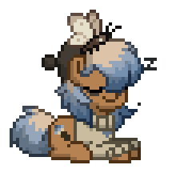
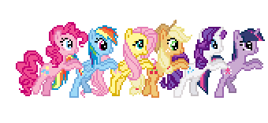
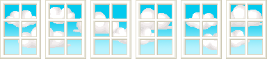

  

<h2 align="center">
  $\color{#38BDF8}{\textsf{welcome!}}$
</h2>

  $\color{#93C5FD}{\textsf{pt player \quad • \quad rp enjoyer \quad • \quad Lifelong Learner}}$

---

### $\color{#38BDF8}{\textsf{01 \quad About Me}}$

> *“Building useful things, exploring new ideas, and keeping it simple.”*

Welcome to my GitHub profile. I enjoy creating clean projects, experimenting with new tools, and documenting what I learn along the way.

---

### $\color{#60A5FA}{\textsf{02 \quad Featured Projects}}$

| Index | Project | Description
| :--- | :--- | :--- | :--- |
| **01** | **Project Alpha** | A brief, clear summary of what this repository does and why it is useful.
| **02** | **Project Beta** | A tool, script, or web app built to solve an everyday problem.
| **03** | **Project Gamma** | An experimental sandbox or guide documenting a specific topic.
| **04** | **Personal Site** | My custom-built corner of the web with notes, links, and updates.

---

### $\color{#7DD3FC}{\textsf{03 \quad Skills and Interests}}$

* **Core Stack:** Web development, scripting, version control, and responsive layouts.
* **Workflow:** Focused on readable code, lightweight design, and practical documentation.
* **Outside of Code:** Music, gaming, design inspiration, and exploring creative communities.

  

  

> [!NOTE]
> Currently working on new character designs and web pages.

<b>Click to open a secret message</b>

 
Thanks for checking out my profile. Stay creative and have fun building things!

  

